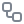
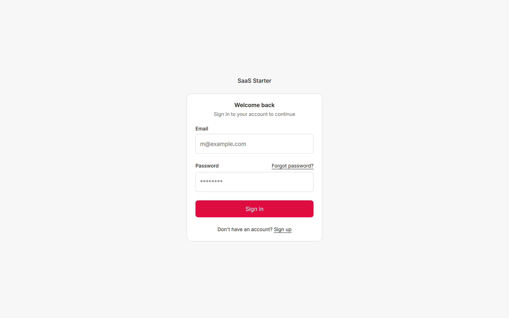
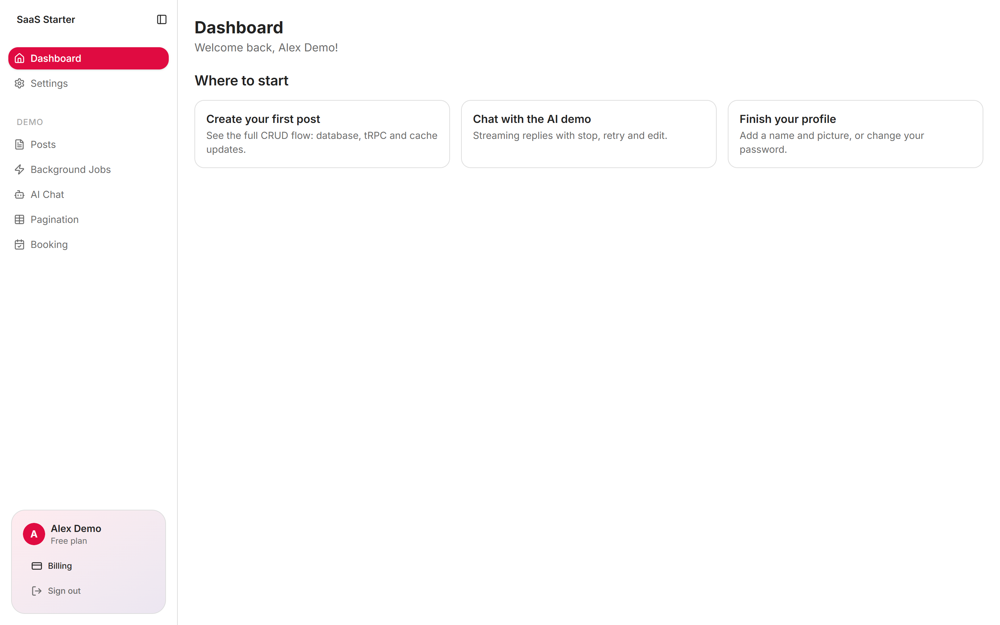
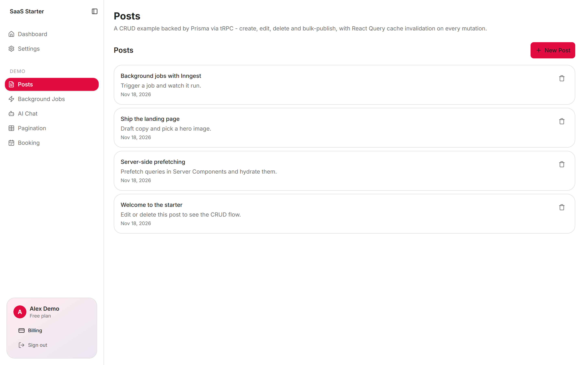
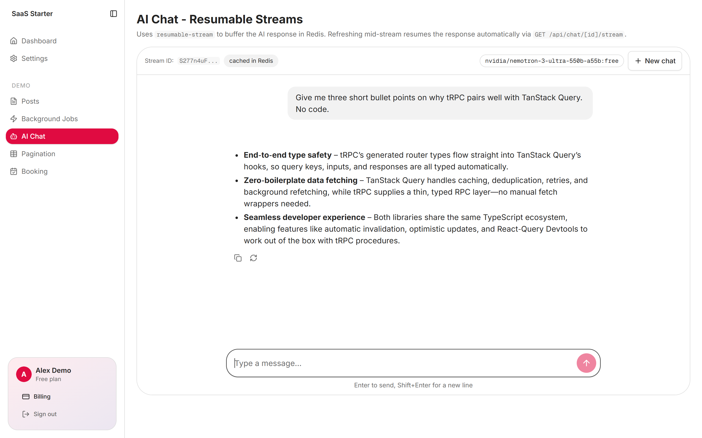
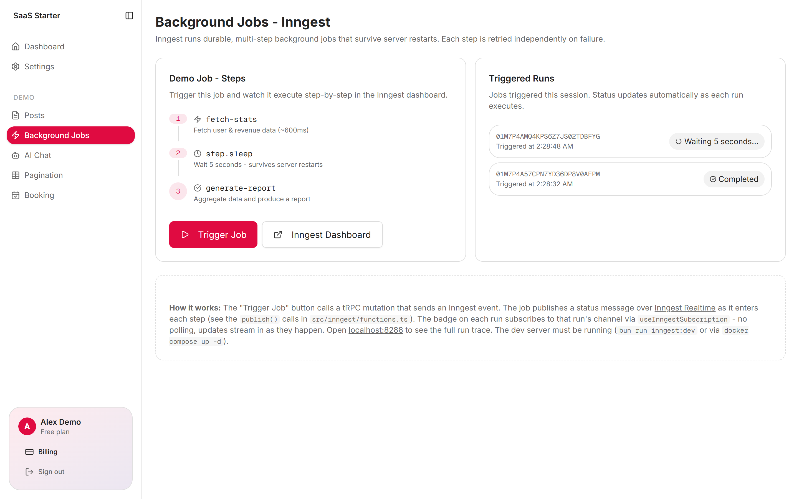
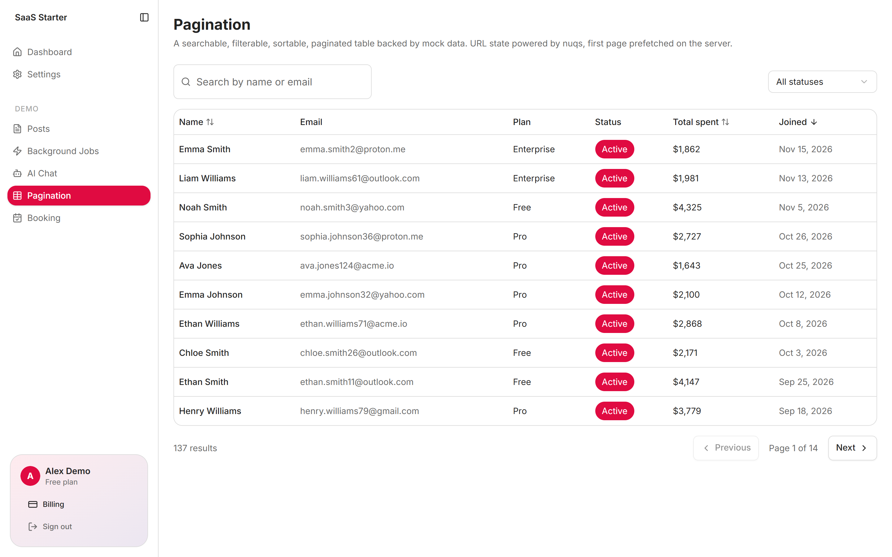
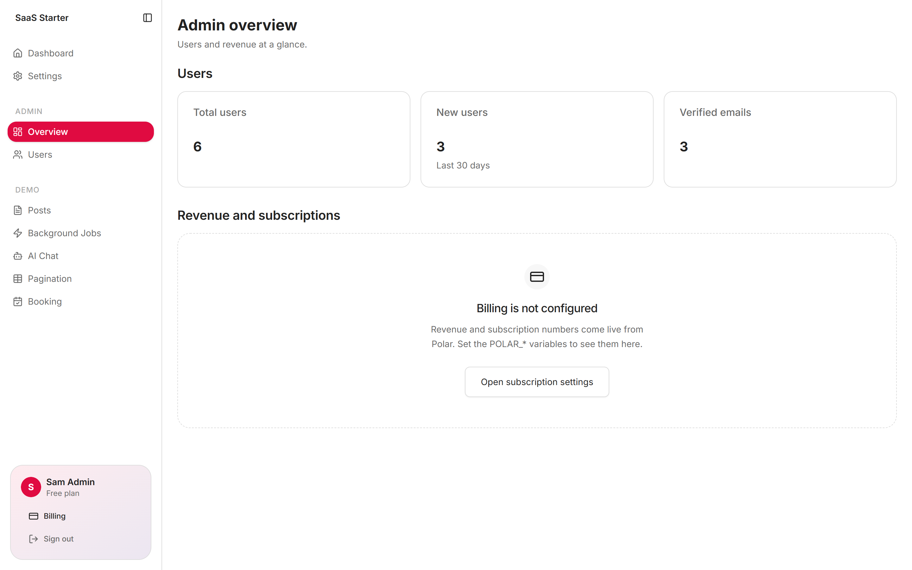
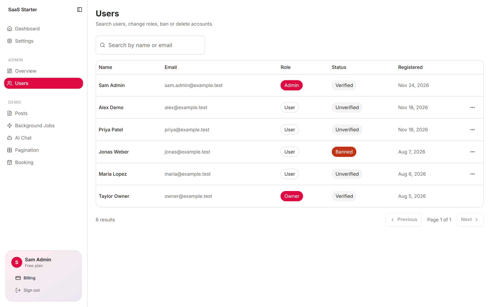

# Next.js SaaS Starter

A production-ready Next.js SaaS template with everything you need to build and ship a modern SaaS application.

## Tech Stack

| Category                      | Technology |
|-------------------------------|---|
| **Framework**                 | &nbsp;Next.js 16 (App Router, Turbopack) |
| **Language**                  | &nbsp;TypeScript (strict mode) |
| **API Layer**                 | &nbsp;tRPC v11 + &nbsp;TanStack Query v5 |
| **Database**                  | &nbsp;PostgreSQL + &nbsp;Prisma ORM |
| **Auth**                      | &nbsp;Better Auth (email/password + &nbsp;Google + &nbsp;GitHub OAuth) |
| **Payments**                  | &nbsp;Polar.sh (subscriptions + customer portal) |
| **Background Jobs**           | &nbsp;Inngest |
| **AI**                        | &nbsp;Vercel AI SDK + &nbsp;OpenRouter |
| **Cache**                     | &nbsp;Redis |
| **Analytics**                 | &nbsp;Plausible (self-hosted or cloud, optional) |
| **Error tracking**            | &nbsp;Sentry (optional) |
| **UI**                        | &nbsp;shadcn/ui + &nbsp;Tailwind CSS v4 |
| **i18n**                      | &nbsp;next-intl (en + de) |
| **State**                     | &nbsp;Zustand (client) + &nbsp;TanStack Query (server) |
| **Input Validation**          | &nbsp;Zod |
| **Forms**                     | &nbsp;React Hook Form + &nbsp;Zod |
| **Linting/Formatting**        | &nbsp;Biome (not ESLint/Prettier) |
| **Package manager / runtime** | &nbsp;Bun |

## Screenshots

<table>
  <tr>
    <td width="50%" valign="top">
      <b>Sign in</b><br>
      Email and password plus Google and GitHub, powered by Better Auth.<br>
      
    </td>
    <td width="50%" valign="top">
      <b>Dashboard</b><br>
      Collapsible sidebar and getting-started cards, rendered on the server.<br>
      
    </td>
  </tr>
  <tr>
    <td width="50%" valign="top">
      <b>Posts (CRUD)</b><br>
      Create, edit and delete with Prisma, tRPC and automatic cache updates.<br>
      
    </td>
    <td width="50%" valign="top">
      <b>AI chat</b><br>
      Streaming answers with Markdown, stop, retry and edit; refreshing mid-stream resumes the reply.<br>
      
    </td>
  </tr>
  <tr>
    <td width="50%" valign="top">
      <b>Background jobs</b><br>
      Durable multi-step Inngest jobs with live run status streamed to the page, no polling.<br>
      
    </td>
    <td width="50%" valign="top">
      <b>Pagination</b><br>
      Searchable, sortable and filterable table with its state kept in the URL.<br>
      
    </td>
  </tr>
  <tr>
    <td width="50%" valign="top">
      <b>Admin overview</b><br>
      Owner and admin roles with user counts and live revenue, MRR and subscriptions from Polar (shown here without Polar configured).<br>
      
    </td>
    <td width="50%" valign="top">
      <b>User management</b><br>
      Search users, appoint admins, ban or delete accounts; owners come from an environment variable.<br>
      
    </td>
  </tr>
  <tr>
    <td width="50%" valign="top">
      <b>Profile and security</b><br>
      Edit your profile, verify your email and change your password.<br>
      
    </td>
  </tr>
</table>

## Quick Start

```bash
git clone <repo-url> my-app && cd my-app
bun install
cp .env.example .env        # fill in DATABASE_URL, BETTER_AUTH_SECRET, etc.
docker compose up -d        # Postgres, Redis, Inngest dev server
bun run prisma:migrate && bun run prisma:generate
bun run dev                 # http://localhost:3000
```

See [**Getting Started**](./docs/getting-started.md) for the full walkthrough, including OAuth and Polar setup.

## Documentation

Full docs live in [`docs/`](./docs/README.md) - readable as plain Markdown, or as a searchable site via `bun run docs:dev` (see [Getting Started](./docs/getting-started.md#reading-these-docs-as-a-website)):

- [Getting Started](./docs/getting-started.md) - local setup
- [Environment Variables](./docs/environment-variables.md) - every env var explained
- [Architecture](./docs/architecture.md) - stack, request flow, project structure
- [Features](./docs/features.md) - existing demo features, adding a new one
- [Database](./docs/database.md) - Prisma schema and migrations
- [Auth & Billing](./docs/auth-and-billing.md) - Better Auth, OAuth, Polar, premium gating
- [Admin Area](./docs/admin.md) - owners, admins, overview numbers, user management
- [Background Jobs](./docs/background-jobs.md) - Inngest
- [Integrations](./docs/integrations.md) - AI, Redis, analytics
- [Frontend](./docs/frontend.md) - UI components, design system, i18n, state management
- [Deployment](./docs/deployment.md) - Docker production setup, pre-deploy checklist

For AI coding agent instructions, see [`CLAUDE.md`](./CLAUDE.md), [`AGENTS.md`](./AGENTS.md), and [`DESIGN.md`](./DESIGN.md).
